<p align="center">
  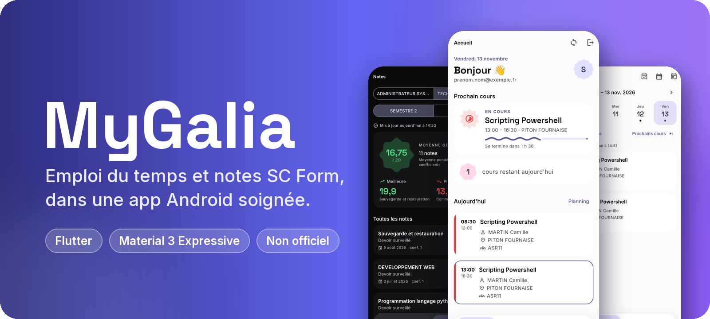
</p>

<h3 align="center">Client Android non officiel de l'espace élève SC Form / GaliaEDC</h3>

<p align="center">
  
  
  
  
</p>

<p align="center">
  <a href="#aperçu">Aperçu</a> •
  <a href="#fonctions">Fonctions</a> •
  <a href="#confidentialité-et-sécurité">Confidentialité</a> •
  <a href="#développement">Développement</a> •
  <a href="#publier-une-version">Publication</a>
</p>

---

Emploi du temps, notes, et un accueil qui résume la journée. Interface
Material 3 Expressive, écrite en Flutter.

> [!IMPORTANT]
> MyGalia n'est ni édité ni approuvé par SC Form. L'app lit les mêmes pages
> que le site officiel, avec vos identifiants, et ne les envoie nulle part
> ailleurs.

## Aperçu

| Accueil | Emploi du temps | Notes | Thème |
| :---: | :---: | :---: | :---: |
| 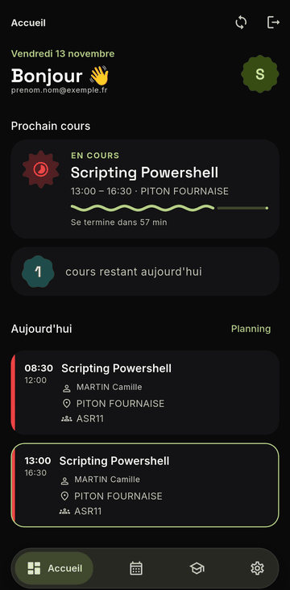 | 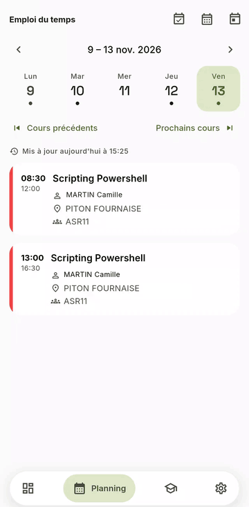 | 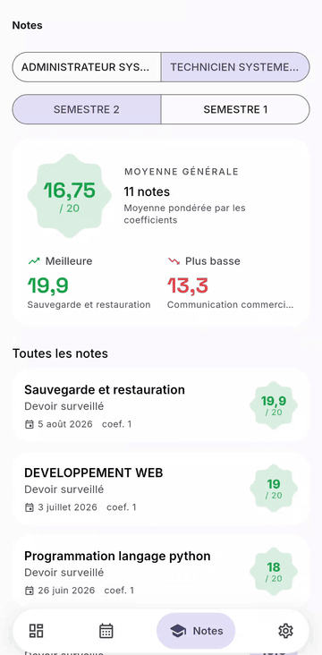 | 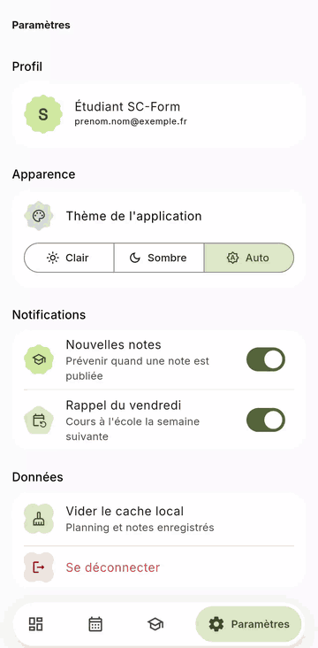 |
| Le cours en cours et sa progression | Semaine par semaine, jour par jour | Cursus, semestres et moyenne | Clair, sombre ou automatique |

### Les quatre écrans

Les captures suivent le thème de votre GitHub : clair ou sombre.

| Accueil | Emploi du temps | Notes | Paramètres |
| :---: | :---: | :---: | :---: |
| <picture><source media="(prefers-color-scheme: dark)" srcset=".github/assets/capture_sombre_home.png"></picture> | <picture><source media="(prefers-color-scheme: dark)" srcset=".github/assets/capture_sombre_planning.png">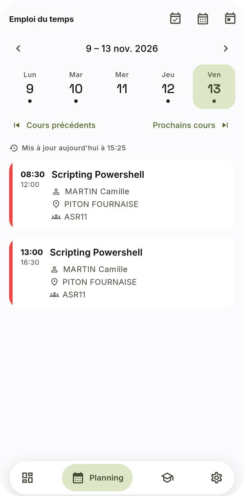</picture> | <picture><source media="(prefers-color-scheme: dark)" srcset=".github/assets/capture_sombre_notes.png">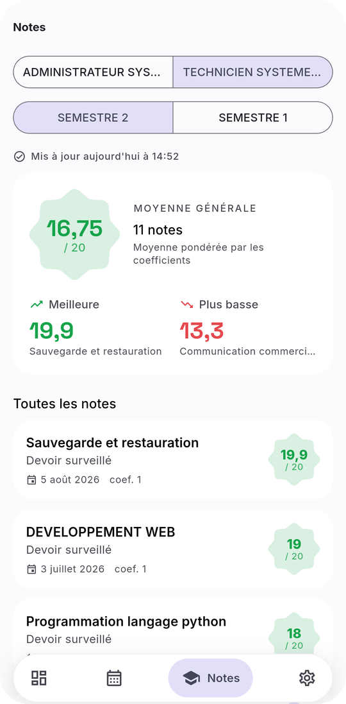</picture> | <picture><source media="(prefers-color-scheme: dark)" srcset=".github/assets/capture_sombre_settings.png">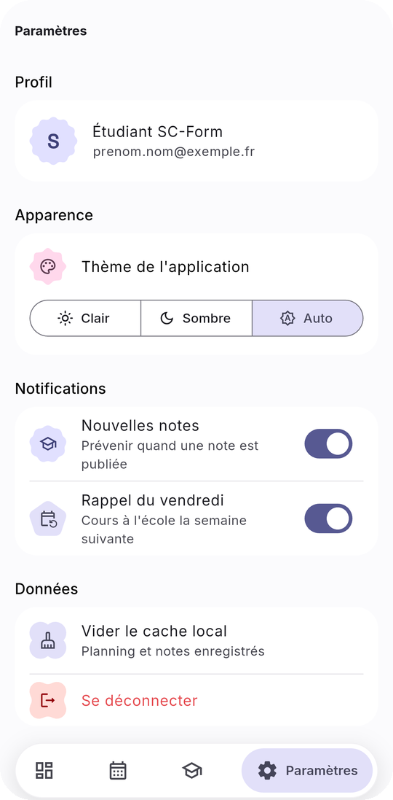</picture> |

### Couleurs du fond d'écran

Sur Android 12 et plus récent, MyGalia reprend la couleur que le système tire
de votre fond d'écran (Material You). Changez de fond : l'app change de teinte
à votre retour, en clair comme en sombre.

| En mouvement | Indigo (par défaut) | Fond terracotta | Fond vert |
| :---: | :---: | :---: | :---: |
| 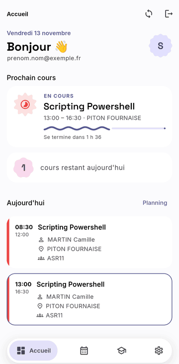 | 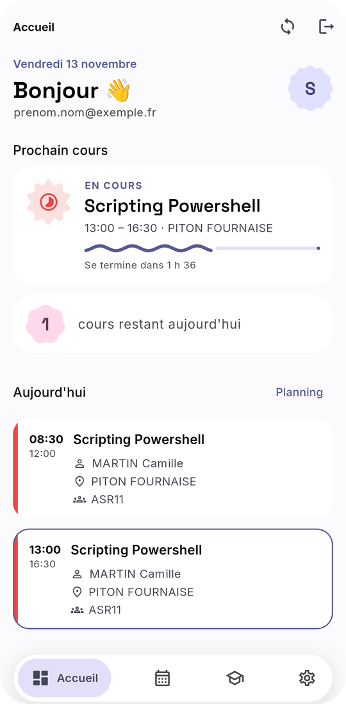 | 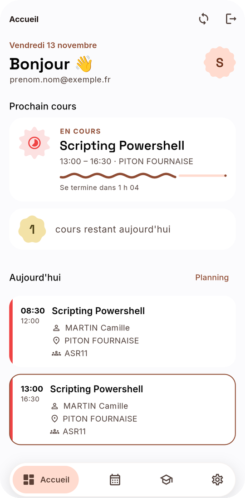 | 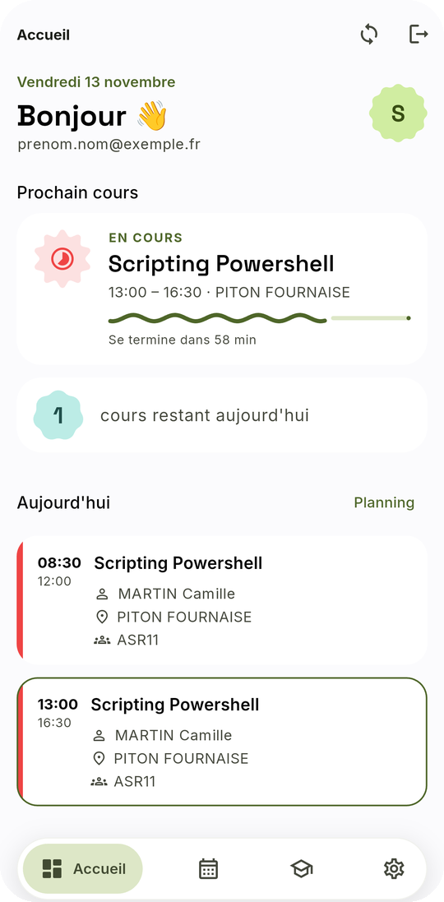 |

Même écran, trois fonds d'écran. L'animation enchaîne ces trois captures.
L'indigo reste la couleur de l'app avant Android 12.

### Clair et sombre

| Clair | Sombre |
| :---: | :---: |
|  | 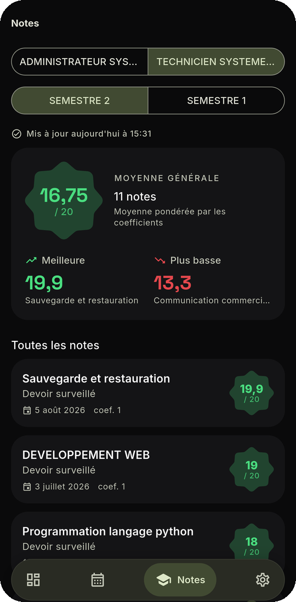 |

Captures prises sur un Pixel 9 Pro. L'adresse e-mail et le nom des formateurs
y sont remplacés par des valeurs fictives.

---

## Fonctions

- **Accueil** : cours en cours ou à venir, planning du jour, dernières notes.
- **Emploi du temps** : semaine par semaine, saut de période de cours en
  période de cours (alternance), export de la semaine vers l'agenda (`.ics`).
- **Notes** : choix du cursus (classe) et du semestre, moyenne pondérée,
  meilleure et plus basse note. Les barèmes autres que /20 sont ramenés sur
  20 ; absences et dispenses sont affichées sans compter dans la moyenne.
- **Notifications** (à activer dans Paramètres) : nouvelle note publiée, et
  rappel le vendredi quand la semaine suivante comporte des cours à l'école.
- **Couleurs dynamiques** : la teinte de l'app suit votre fond d'écran
  (Android 12+), en thème clair, sombre ou automatique.
- **Hors ligne** : les dernières données valides restent consultables.

## Confidentialité et sécurité

- Identifiants, jeton et session : coffre chiffré (Keystore Android).
- Planning et notes en cache : boîte Hive chiffrée en AES, clé dans le coffre.
- Aucune sauvegarde cloud ni transfert d'appareil des données de l'app.
- Journaux de diagnostic actifs en debug seulement, secrets masqués.
- Seuls serveurs contactés : ceux de SC Form. Les polices sont embarquées.

## Respect du serveur de l'école

- Deux relances automatiques au plus, avec délai croissant.
- Une seule reconnexion à la fois, quel que soit le nombre d'écrans.
- Vérification en arrière-plan : quatre fois par jour au plus, et seulement
  si une notification est activée.

Le détail des garanties (session, cache, erreurs) est dans
[FIABILITE.md](FIABILITE.md).

## Développement

Prérequis : Flutter stable (3.44 ou plus récent) et le SDK Android 37.

```bash
flutter pub get
```

```bash
flutter analyze
```

```bash
flutter test
```

```bash
flutter run
```

Les tests n'appellent jamais le vrai portail : ils tournent contre un faux
serveur local (`test/support/fake_scform_server.dart`).

### Organisation du code

```
lib/
  core/        réseau, session, stockage, thème, widgets communs
  features/
    auth/            connexion, ouverture de la session école
    home/            accueil
    schedule/        emploi du temps, recherche de période, export agenda
    grades/          notes, cursus, semestres
    notifications/   nouvelles notes, rappel du vendredi, tâche de fond
    settings/        paramètres
```

Les paramètres du protocole (URL, noms des champs WebForms) sont regroupés
dans `lib/core/network/scform_config.dart`.

## Publier une version

1. Créer une clé de signature, une seule fois, et la garder hors du dépôt :

   ```bash
   keytool -genkey -v -keystore mygalia-release.jks -keyalg RSA -keysize 2048 -validity 10000 -alias mygalia
   ```

2. Copier `android/key.properties.example` en `android/key.properties` et y
   renseigner le chemin de la clé et ses mots de passe. Ce fichier et les
   `.jks` sont ignorés par git.
3. Augmenter `version` dans `pubspec.yaml` (le nombre après `+` doit croître
   à chaque publication).
4. Construire :

   ```bash
   flutter build apk --release
   ```

Sans `android/key.properties`, la version release est signée avec la clé de
debug : pratique pour essayer, **à ne pas distribuer**. Perdre la clé de
signature empêche de publier des mises à jour installables par-dessus
l'ancienne version : sauvegardez-la ailleurs que sur ce PC.
